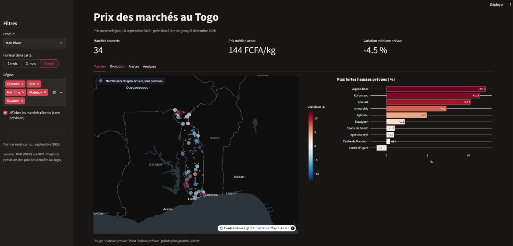
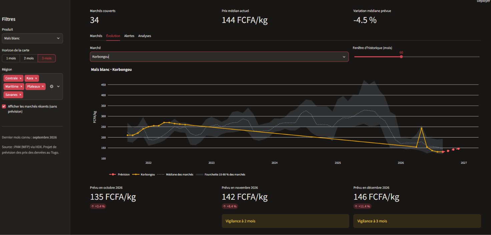
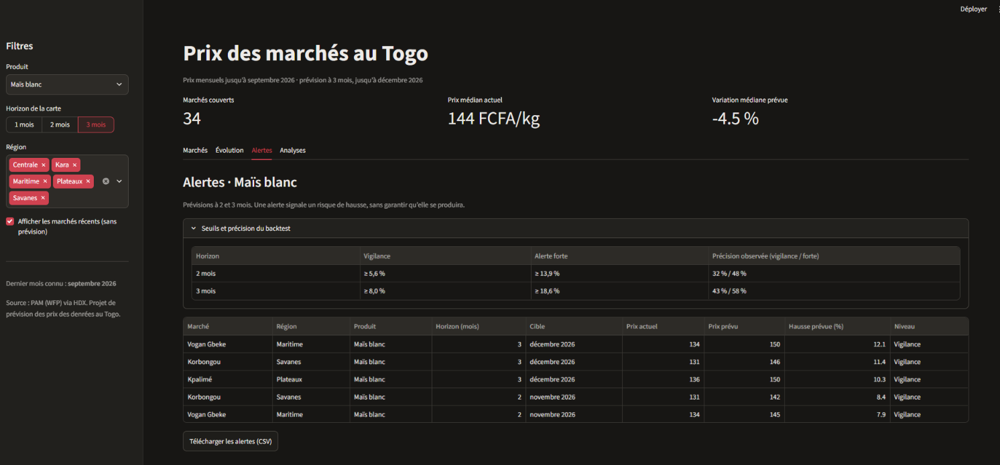

# Prévision des prix des denrées alimentaires au Togo

Prévision à 1, 2 et 3 mois des prix de marché de huit denrées de base, cartographie des variations attendues et
alertes de hausse, à partir des relevés du Programme alimentaire mondial (PAM).




## Sommaire

1. [Contexte](#1-contexte)
2. [Données](#2-données)
3. [Approche](#3-approche)
4. [Résultats](#4-résultats)
5. [Alertes](#5-alertes)
6. [Application](#6-application)
7. [Limites](#7-limites)
8. [Structure du dépôt](#8-structure-du-dépôt)
9. [Installation et utilisation](#9-installation-et-utilisation)
10. [Pistes d'amélioration](#10-pistes-damélioration)

## 1. Contexte

Au Togo, le prix des céréales, légumineuses et dérivés du manioc varie fortement selon la saison, le marché et les
chocs d'approvisionnement. Producteurs et commerçants vendent ou achètent souvent au mauvais moment, faute de
visibilité sur les prix à venir.

Le projet répond à trois questions :

- Quel sera le prix d'un produit sur un marché donné dans 1, 2 ou 3 mois ?
- Où les prix sont-ils attendus en hausse ou en baisse ?
- Quels marchés présentent un risque de forte hausse, et avec quelle fiabilité peut-on l'annoncer ?

Une attention particulière est portée à l'évaluation : chaque modèle est comparé à des prévisions de référence
simples, et les résultats sont détaillés par année et par produit plutôt que moyennés.

## 2. Données

| | |
|---|---|
| Source | Prix de détail relevés par le PAM (WFP), publiés sur HDX (jeu de données *wfp-food-prices-for-togo*) |
| Période | Janvier 2001 à septembre 2026, relevés mensuels |
| Volume | 48 725 observations, 119 marchés |
| Produits retenus | Maïs blanc, gari (dérivé du manioc), haricots blancs, haricots rouges, soja, sorgho rouge, riz local, mil |
| Unité | FCFA par kilogramme, prix de détail, valeurs observées |

**Deux groupes de marchés.** Le réseau de suivi s'est élargi au fil du temps (6 marchés avant 2015, environ 40 de
2015 à 2025, plus de 100 depuis avril 2026). On distingue donc :

- 43 marchés à historique long (plus de 5 ans), utilisés pour l'entraînement et l'évaluation ;
- 76 marchés récents, affichés avec leur prix actuel mais sans prévision, faute d'historique suffisant.

**Qualité.** Le fichier ne contient ni valeur manquante ni doublon. Trois points ont été traités :

- 111 valeurs aberrantes (0,24 % des relevés), repérées lorsqu'un prix s'écarte à la fois de sa propre série et des
  autres marchés du même mois. Leur retrait ne modifie pratiquement pas les résultats ;
- des prix recopiés d'un mois à l'autre sur certaines périodes (par exemple 96 % des prix identiques à ceux du
  mois précédent en novembre 2024), vraisemblablement des relevés non effectués. Ces mois sont identifiés et traités
  à part lors de l'évaluation ;
- 81 séries sans relevé en septembre 2026, exclues de la prévision.

## 3. Approche

```
Téléchargement (API HDX) -> Nettoyage -> Construction des variables -> Modèle -> Prévisions -> Alertes -> Application
```

**Nettoyage.** Dates ramenées au premier du mois, interpolation des trous de 2 mois au plus (les valeurs comblées
sont marquées et exclues de l'évaluation), marquage des aberrants et des prix recopiés. Deux versions du panel sont
produites, nettoyée et brute. L'évaluation porte toujours sur la version brute.

**Modèle.** Un modèle LightGBM global, commun à tous les marchés et produits, par horizon de prévision. Il prédit la
variation du logarithme du prix par rapport au prix actuel plutôt que le prix lui-même : il part ainsi de la
prévision naïve et n'apprend que les corrections. Perte en erreur absolue, 400 arbres, taux d'apprentissage 0,03.

Variables, toutes calculées sur le passé uniquement :

| Variable | Description |
|---|---|
| `d1`, `d3`, `d12` | Variation du prix sur 1, 3 et 12 mois |
| `dev6`, `vol6` | Écart à la moyenne des 6 derniers mois, volatilité récente |
| `rel`, `nat_d3` | Prix relatif à la médiane nationale du produit, variation récente de cette médiane |
| `month_t` | Mois du prix à prévoir (saisonnalité) |
| `commodity`, `admin1`, `lat`, `lon` | Produit, région, position du marché |

**Évaluation.** Validation temporelle : pour chaque année de 2022 à 2026, le modèle est entraîné sur les données
antérieures au 1er janvier de l'année testée, puis évalué sur cette année. Aucun mélange aléatoire des dates. Le
modèle et les références sont comparés sur exactement les mêmes observations (environ 16 000 par horizon).

Références : prévision naïve (prix du dernier mois connu) et prévision saisonnière (prix du même mois l'année
précédente). Métriques : MAE (FCFA/kg) et MAPE (% du prix).

## 4. Résultats

Erreur moyenne en pourcentage (MAPE), sur 2022-2026. Plus bas est meilleur.

| Horizon | Saisonnière | Naïve | Modèle | Gain vs naïve |
|---|---|---|---|---|
| 1 mois | 23,8 % | 10,0 % | 10,0 % | nul |
| 2 mois | 23,8 % | 14,5 % | 13,9 % | environ 4 % |
| 3 mois | 23,8 % | 17,8 % | 16,4 % | environ 8 % |

- Le modèle n'apporte rien à 1 mois : le prix du mois précédent est déjà presque la meilleure information.
- À 3 mois, le gain est positif chaque année (de +2,5 % en 2024 à +11,2 % en 2025) et pour chacun des huit produits
  (de +6,1 % à +11,0 %).
- Le retrait des mois à prix recopiés ne modifie pas la conclusion (gain de 2 à 9 % selon l'horizon).
- Entraîner le modèle sur le panel nettoyé ou sur le panel brut donne des erreurs équivalentes (9,9 / 13,9 / 16,4 %
  contre 10,0 / 13,9 / 16,4 %).

## 5. Alertes

Une alerte est émise lorsque la hausse prévue figure parmi les plus fortes observées lors du test. L'événement à
détecter est une hausse réelle d'au moins 15 % par rapport au prix actuel.

| Horizon | Vigilance (top 20 %) | Alerte forte (top 5 %) |
|---|---|---|
| 2 mois | hausse prévue de 5,6 % ou plus | 13,9 % ou plus |
| 3 mois | hausse prévue de 8,0 % ou plus | 18,6 % ou plus |

Aucune alerte à 1 mois, le modèle ne dépassant pas la référence naïve.

Part des alertes de niveau fort (top 5 %) suivies d'une hausse réelle d'au moins 15 %, à 3 mois :

| Règle | Précision |
|---|---|
| Hasard (fréquence de base) | 22 % |
| Momentum (une hausse récente se poursuit) | 14 % |
| Rebond (une baisse récente est suivie d'une remontée) | 49 % |
| Modèle | 58 % |

Le modèle fait 2,7 fois mieux que le hasard, avec une régularité satisfaisante d'une année à l'autre. Il ne dépasse
toutefois que modérément la règle simple du rebond.

## 6. Application

L'application Streamlit propose 4 vues : carte des variations prévues, évolution d'un marché avec prévision, alertes et analyses qui regroupent 4 parties qui sont résultats du modèle , qualité des données ,saisonnalité, comparaison des produits





## 7. Limites

- Aucun gain à 1 mois, gain modeste à 2 et 3 mois.
- L'avantage sur la règle du rebond est faible : une part du signal est une règle simple de retour vers la moyenne.
- La forte hausse de 2024 n'est presque pas détectée (peu d'alertes cette année-là).
- Les alertes suivent surtout la saisonnalité (octobre à février) et ne signalent pas de façon fiable des chocs
  brutaux et imprévus.
- Les prix recopiés d'un mois à l'autre fragilisent l'évaluation sur certaines périodes, notamment 2024.
- Les seuils d'alerte sont calibrés sur la période de test, ce qui les rend légèrement favorables au modèle.
- Les marchés récents n'ont pas de prévision, et 81 séries sans relevé en septembre 2026 sont exclues.

## 8. Structure du dépôt

```
.
├── app/streamlit_app.py        Application
├── data/
│   ├── raw/                    CSV brut téléchargé (jamais modifié)
│   └── processed/              Panels nettoyés et prévisions
├── docs/images/                Captures d'écran du README
├── notebooks/
│   ├── 01_audit_donnees.ipynb  Exploration et qualité des données
│   ├── 02_baselines.ipynb      Prévisions de référence
│   ├── 03_modele.ipynb         Modèle et validation temporelle
│   └── 04_alertes.ipynb        Évaluation des alertes
├── src/
│   ├── data/                   download.py, clean.py
│   ├── evaluation/             baselines.py
│   ├── models/                 lgbm.py, forecast.py
│   └── alerts/                 rules.py
├── reports/
├── requirements.txt
└── .gitignore
```

## 9. Installation et utilisation

```bash
python -m venv venv
venv\Scripts\activate            # Windows (Linux/macOS : source venv/bin/activate)
pip install -r requirements.txt
```

Depuis la racine du projet, dans cet ordre :

```bash
python src/data/download.py              # télécharge le CSV dans data/raw/
python src/data/clean.py                 # panel nettoyé et marchés récents
python src/data/clean.py --no-clean      # panel brut (utilisé pour la prévision)
python src/models/forecast.py            # prévisions -> data/processed/previsions.csv
streamlit run app/streamlit_app.py       # application
```

Les notebooks 01 à 04 reproduisent l'audit, les références, la validation du modèle et l'évaluation des alertes.

Les fichiers de données ne sont pas versionnés : ils se régénèrent avec les commandes ci-dessus. Lors d'une mise à jour
du jeu de données par le PAM, relancer ces commandes ; le modèle est ré-entraîné à chaque prévision. Sur la durée,
vérifier que l'erreur sur les mois récents reste comparable à celle du backtest.

## 10. Pistes d'amélioration

- Ajouter des variables externes : prix du carburant, taux de change, pluviométrie.
- Produire des intervalles de prévision plutôt qu'une valeur unique.
- Recouper les épisodes de prix recopiés avec une seconde source (INSEED).
- Intégrer les marchés récents lorsque leur historique sera suffisant.
- Automatiser la chaîne complète avec des contrôles de qualité à chaque mise à jour.


Données : Programme alimentaire mondial (PAM / WFP) via HDX ; les conditions d'utilisation figurent sur la page du jeu
de données.